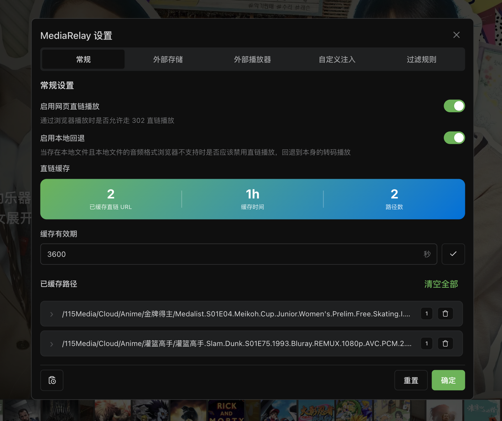
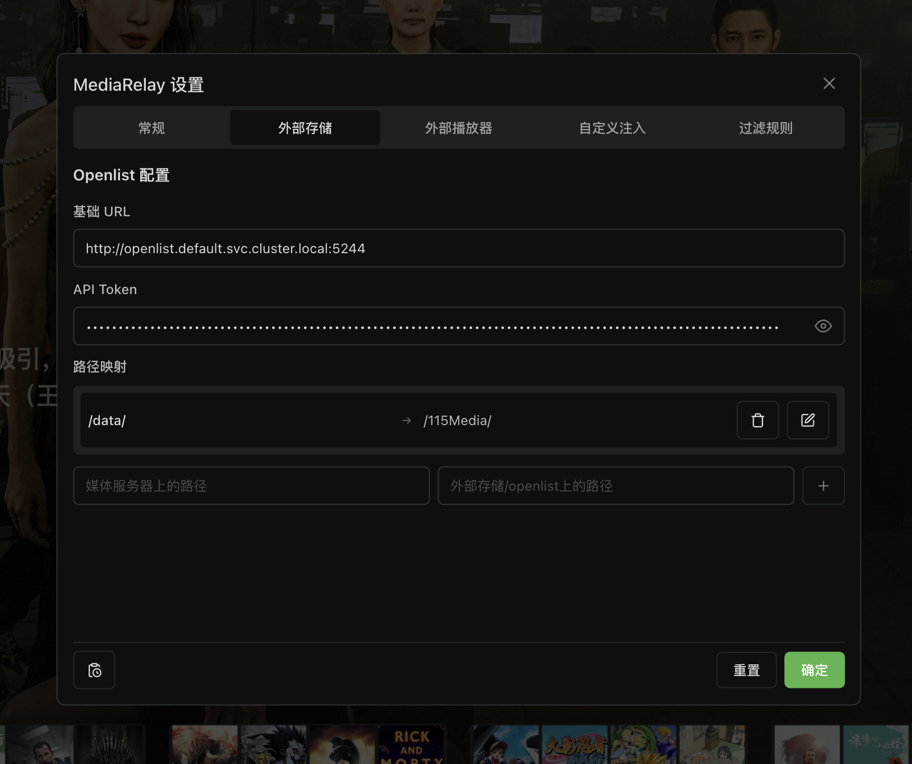
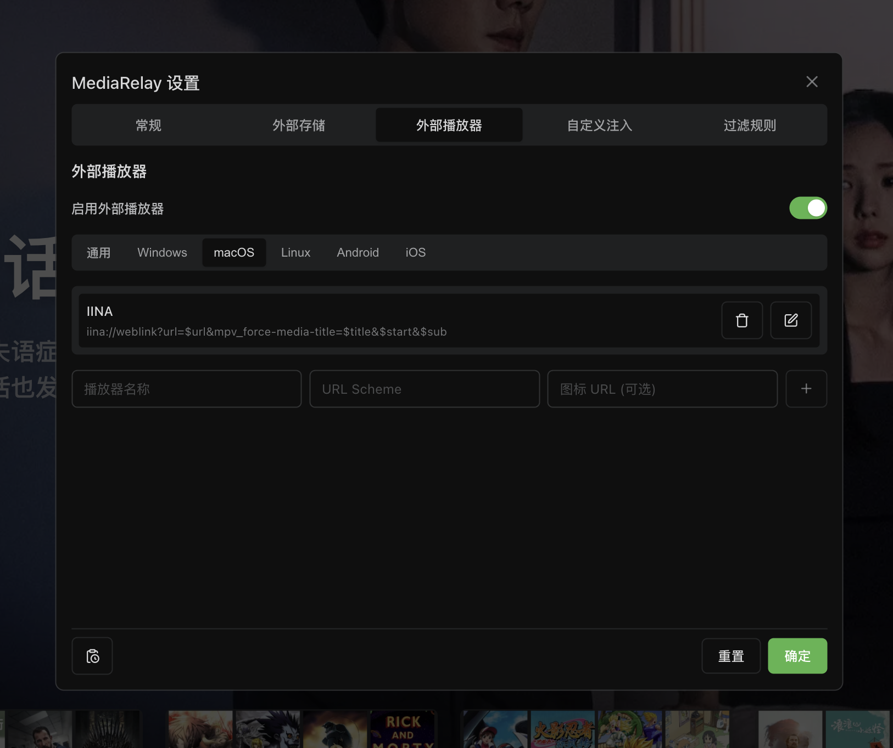
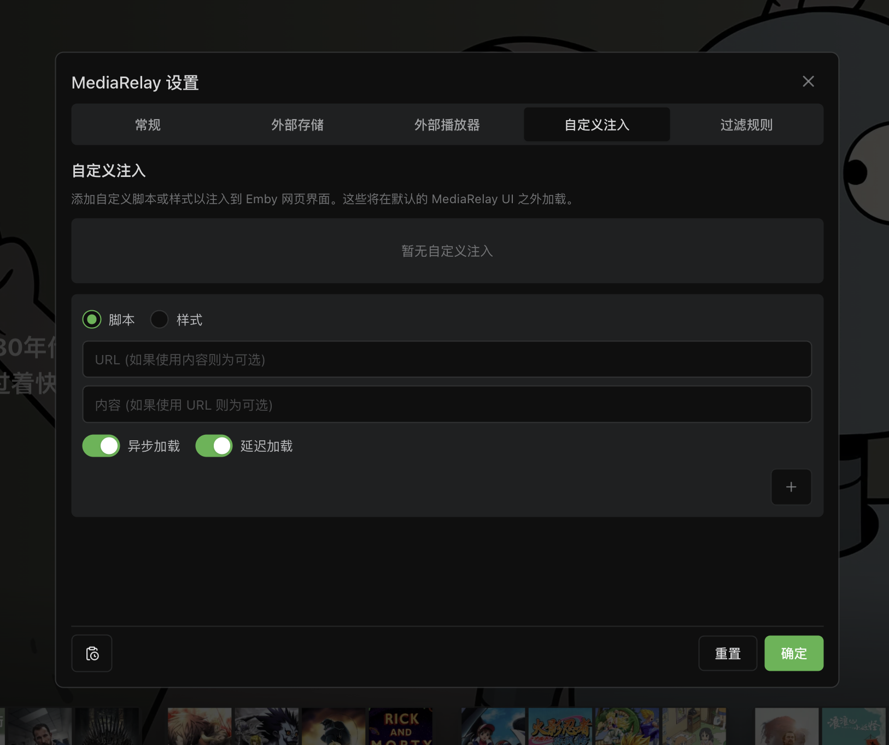
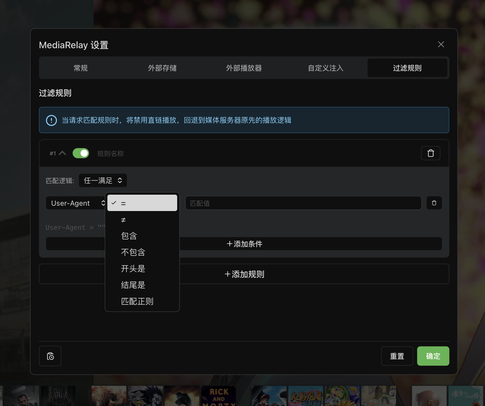
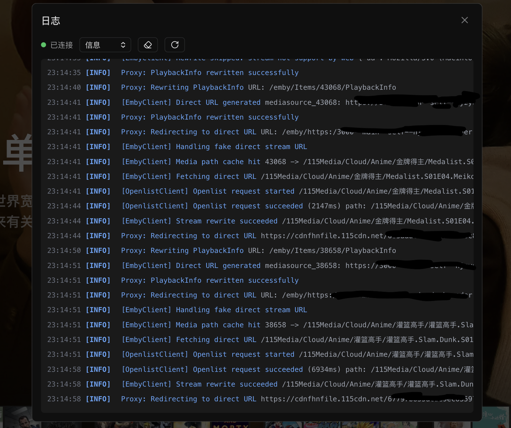

# MediaRelay

> 本分支为 Rust 版本：Rust 是唯一后端，前端构建使用 Node.js + pnpm，不再依赖 Deno。迁移保留现有 Emby/Jellyfin UI、管理 API 和配置格式。

一款旨在改善 Emby/Jellyfin 公网观看体验的请求中继/代理工具。通过 Openlist 将可直链播放的视频流请求 302 重定向到网盘直链，减少视频中转对媒体服务器上行带宽的依赖。支持本地视频有对应网盘副本和 STRM 媒体库两种场景；实际观看效果仍取决于网盘、客户端网络、视频码率及配置。

> [!IMPORTANT]
> 仅限个人使用，多人使用下，网盘封控概率会很大，且是否能成功302直链访问依赖因素也比较多，所以 GitHub Issues 暂时关闭，如有使用问题、建议或功能反馈，请先加入 [TG](https://t.me/+fFFWvWa0yxxiYTdl) 进行沟通

## 功能特性

- **302网盘直链重定向** 利用 openlist 获取网盘直链并结合 lru 缓存和请求合并功能，尽可能加速起播速度并降低网盘封控概率，核心支持两种场景：
  - 存在本地媒体文件，且媒体文件通过类似 cd2 方式已备份到远程网盘，此时可通过在 openlist 上挂载对应网盘并使用 mediarelay 的 pathmap 能力实现直接走网盘直链播放
  - [openlist strm](https://doc.oplist.org/guide/advanced/strm)
- **web 外部播放器** 支持在 emby/jellyfin web 页面上通过外部播放器进行播放
  - 新增/修改播放器 scheme 可视化配置且不同平台仅展示对应平台播放器
  - 深度适配 iina，支持标题、外挂字幕、跳转历史播放位置 需下载[自编译版本](https://github.com/njzydark/iina/actions/runs/21243531374#artifacts)
- **js/css 注入**
- **规则过滤** 完善的规则过滤功能，可根据 ua，hostname，ip，媒体文件路径等信息灵活控制是否应该跳过直链播放
- **webui** 提供 webui 进行可视化配置，并深度适配 emby/jellyfin，就像内置功能一样，可在原 web 页面上直接进行配置
  - pc/移动端适配
  - 适配 emby/jellyfin 夜间模式
  - 完善的日志功能，中继/代理核心链路日志全覆盖

## 快速开始

前置依赖：

- emby/jellyfin 媒体服务
- openlist

```bash
# emby
docker run -d --name mediarelay -e EMBY_URL=http://xxx:8096 -v ./config:/app/config -p 3000:3000 ghcr.io/njzydark/mediarelay:rust
# jellyfin
docker run -d --name mediarelay -e JELLYFIN_URL=http://xxx:8096 -v ./config:/app/config -p 3000:3000 ghcr.io/njzydark/mediarelay:rust
```

访问 3000 端口，点击顶部头像即可看到 mediarelay 功能设置入口

## WebUI 功能展示

常规设置下主要是查看直链缓存情况和控制 webDirect 开关



外部存储用于配置 openlist 和进行 path map



配置外部播放器 scheme



如果需要注入额外的 js/css 可以使用此功能



目前主要是一些基础的 ua ip 规则



用于排查问题，核心日志链路全覆盖



## Dev

安装 Rust（`rustup` 会按 `rust-toolchain.toml` 安装固定版本）、Node.js 24 LTS（版本见 `.node-version`）和 Corepack。在仓库根目录执行：

pnpm 固定为最新稳定版 `12.15.0`，`tsc` 使用最新稳定版 TypeScript `7.0.2`。检查与格式化使用 Oxc 的 `oxlint` / `oxfmt`，不依赖 ESLint、Prettier 或旧版 TypeScript 兼容包。

```bash
corepack enable
pnpm install --frozen-lockfile

# 构建 Web UI / Emby / Jellyfin 注入脚本并启动 Rust 后端
EMBY_URL=http://127.0.0.1:8096 pnpm dev
# 或 JELLYFIN_URL=http://127.0.0.1:8096 pnpm dev

# 单独启动前端开发服务器，API 代理至 localhost:3000
pnpm dev:web

# 发布构建
pnpm build
cargo build --release --locked
EMBY_URL=http://127.0.0.1:8096 ./target/release/mediarelay
```

默认读取 `./config/config.json`（不是 `apps/server/config.json`）；可通过 `CONFIG_DIR` 指定配置目录，通过 `STATIC_DIR` 指定静态资源目录。仓库根目录启动时，静态资源默认位于 `apps/server/static`。默认端口为 3000；修改配置中的端口后需重启服务。

保留的环境变量：`EMBY_URL`、`JELLYFIN_URL`、`OPENLIST_BASE_URL`、`OPENLIST_TOKEN`、`CONFIG_DIR`，环境变量优先于配置文件。支持根目录 `.env`，已有进程环境变量优先。Emby 与 Jellyfin 都配置时优先使用 Emby。日志级别可通过 `RUST_LOG=mediarelay=debug` 设置。

### 数据透传

- 普通代理流式转发原始 body，不自动跟随 302、不自动解压、不重新序列化 JSON。
- PlaybackInfo 基于完整 JSON 树局部修改，保留未知嵌套字段、null、缺失字段及任意精度数字。改写响应不保证空白、字段顺序或数字文本形式一致；Jellyfin 不需要的转码字段会删除，而非输出 null。
- 改写最多缓冲 8 MiB，等待 body 最多 15 秒，支持 gzip/br/deflate/zstd；超过上限、编码不支持、结构不兼容或 JSON 无效时透传原响应。普通媒体流不受此缓冲上限限制。
- 配置保留未知字段；Openlist 局部合并，其余配置沿用既有更新语义（例如播放器配置整体替换，省略 injections 时清空自定义注入）。媒体服务地址仅在启动时设置，管理 API 不允许替换。
- 保留 ECMAScript 正则过滤语法，包括 lookaround/backreference；规则由管理员配置，应避免具有灾难性回溯的表达式。内网地址判断使用标准 IP 解析，支持 IPv6。
- 缓存管理显示实际过期时间。直链有效期扣除三分钟预留时间，且不超过缓存最大时长；更新配置或清空缓存后，旧请求不会重新填入过期配置的直链。
- pathMap 按配置顺序执行首次字符串替换，保留 JS 替换值中的特殊序列语义（包括 `$$`、`$&`、`$'` 和美元符号加反引号）；没有正则捕获组时，`$1` 等保持字面量。

### STRM 与内部 API

- Emby 的 PlaybackInfo/缓存中已有的 STRM 路径继续进入 pathMap → Openlist，不检查目标文件是否在本地存在，也不额外读取 STRM 文件。
- Jellyfin 从缓存路径识别 STRM 后，通过媒体服务器读取文件内容；内容可以是 HTTP 地址或需要映射的文件路径。读取失败、内容为空或超过安全上限时，保留原路径继续尝试 Openlist，而不是直接放弃直链。
- 保留旧版冷缓存语义：直接播放且尚无 PlaybackInfo 缓存时，媒体查询返回的未解析 STRM 先写入缓存，本次回退上游；后续请求可使用缓存路径。正常 PlaybackInfo → 播放流程不经过这一步冷缓存回退。
- 媒体路径缓存只保存路径字符串，缓存命中只返回 `Path`，保留旧版过滤规则收到的字段形态。保存播放器、过滤规则或 Openlist 设置不会清除已预热的媒体路径；过滤规则仍立即按新配置执行，Openlist 直链缓存则独立失效。
- 内部媒体查询、管理员校验、STRM 和 Openlist API 按 Fetch 规则跟随重定向：301/302 的 POST、303 的非 GET/HEAD 请求转为 GET，307/308 保留方法和 body；普通代理仍原样透传重定向。
- 内部重定向最多 20 次，共享 15 秒请求时限；跨源时移除 Authorization、Cookie 和媒体 token 头，不允许 HTTPS 降级到 HTTP。STRM 的压缩和解压后文本均限制为 64 KiB，普通媒体流不受此限制。

### 排查日志

终端、管理 UI 和 SSE 使用同一份日志详情。可通过 `requestId` 关联请求、缓存、STRM、Openlist、重定向与回退决策；详情包含媒体 ID、脱敏路径、pathMap 结果、HTTP 状态、Openlist API code、耗时和明确的失败原因。`RUST_LOG=mediarelay=debug` 可在终端显示缓存更新与内部重定向等调试信息；UI 可切换日志级别查看。

403 会区分媒体查询/管理员校验、STRM 读取、Openlist 请求和最终上游代理阶段。服务端只能看到自身处理的响应，无法看到浏览器跳转 CDN 后收到的 403；这类情况需结合浏览器网络面板检查。日志不输出 token、Cookie、直链签名、远程媒体完整路径或响应正文。成功读取日志/SSE 不会再生成自身日志，避免递归刷屏。

普通代理的传输错误包含 `operation=proxy`、`stage=response_headers/response_body` 和脱敏后的 `reason`，区分超时、连接拒绝/断开、TLS 或 HTTP 协议错误；响应已开始后的 body 错误只能记录并终止传输，不能改写成新的 HTTP 状态。

### 内存边界

媒体路径与直链缓存分别最多 500 项；媒体缓存不保留 MediaStreams 或未知扩展 JSON。日志保留最近 1,000 条，轮询/SSE 快照共享不可变记录，不复制整份详情文本。HTTP 客户端复用连接，保留原有的 90 秒空闲超时，不额外设置空闲连接数量上限。

HTML/PlaybackInfo 重写不增加固定并发上限或排队机制，保持原版的并发处理方式。8 MiB 是单份输入/解压数据的上限，不是进程总内存上限，JSON 树、并发响应及分配器保留空间仍会影响 RSS。

### 验证

```sh
cargo fmt --check
cargo clippy --workspace --all-targets --locked -- -D warnings
cargo test --workspace --locked
cargo build --release --locked
pnpm check
pnpm lint
pnpm fmt:check
pnpm test
pnpm build

# 本地构建镜像，不会发布
docker build -t mediarelay:rust .
docker run --rm -e EMBY_URL=http://host.docker.internal:8096 -p 3000:3000 mediarelay:rust
```

`apps/server/tests/fixtures/playback.json` 来自迁移基线 `fce33e1` 的原始 TS 改写逻辑，覆盖 Emby/Jellyfin、浏览器开关、音轨回退和过滤跳过。`apps/server/tests/legacy_parity.rs` 补充完整请求序列：PlaybackInfo → 路径缓存 → STRM → pathMap → Openlist，并覆盖冷缓存、读取失败、压缩、内部 API 重定向、鉴权头透传及诊断日志。`apps/server/tests/review_regressions.rs` 覆盖保存设置后的 STRM 播放、路径缓存字段形态与过滤结果、JS 替换值、日志共享、无额外排队的并发重写及代理传输错误。其他测试覆盖字段透传、代理及并发行为，均使用本地模拟服务，不需要网盘凭据。真实媒体服务和网盘的播放验收仍需使用自己的环境。

Docker 镜像保留 `/app/config` 挂载约定，仅包含 Rust 可执行文件与静态资源，不需要 Node.js/Deno。此分支的镜像工作流默认标签为 `rust`；在维护者发布之前，请先本地构建，已有 `latest` 不受影响。

## 官网开发与 GitHub Pages

官网位于 `apps/site`，是独立的简体中文静态页面，包含本地文件 / STRM 共用的播放链路演示、两种接入方式说明、功能截图、资源占用与快速开始。它不访问管理 API，也不包含在 Rust 服务的静态资源或 Docker 运行时中。资源占用的样本来源、统计口径与复测方法见 [RESOURCE_USAGE.md](./apps/site/RESOURCE_USAGE.md)，不是固定性能承诺。

使用 `.node-version` 中的 Node.js 24.18.1 与 `package.json` 中的 pnpm 12.15.0，在仓库根目录执行：

```bash
pnpm install --frozen-lockfile
pnpm dev:site       # 开发服务器 http://localhost:3002
pnpm build:site     # 构建到 apps/site/dist，并检查根路径和 /MediaRelay/ 下的资源引用
pnpm preview:site   # 预览生产构建
```

根级 `pnpm check`、`pnpm lint`、`pnpm fmt:check`、`pnpm test` 已包含官网；`pnpm build` 仍只构建原有管理界面和注入脚本，官网单独执行 `pnpm build:site`。动画只是示意，不会访问真实媒体服务或解析直链；开启系统的“减少动态效果”后显示静态链路及完整阶段说明。

### 首次发布

1. 在仓库 **Settings → Pages → Build and deployment** 中，将 **Source** 选择为 **GitHub Actions**。
2. 检查 **Settings → Environments → github-pages**，允许 `feat/website` 分支部署。如果采用 Selected branches and tags，添加该分支规则；只允许默认分支会阻止官网发布。
3. 将官网分支推送到远程：`git push -u origin feat/website`。本地构建不会自动推送或发布。
4. 查看 **Actions → Website Pages**。工作流先检查、测试和构建，再部署 `apps/site/dist`；成功后默认访问 <https://njzydark.github.io/MediaRelay/>。

后续向 `feat/website` 推送会重新发布；相关 PR 只检查和构建，不部署。工作流不依赖默认分支上的手动触发入口，不需要额外部署 token。若要更换发布分支，需要同时修改工作流触发条件、部署条件和 environment 的分支规则。

官网使用相对静态资源地址与页内锚点，支持根路径和 `/MediaRelay/` 项目路径，不需要 SPA 路由回退。首版未配置自定义域名；若将来更换部署地址，还需同步调整页面分享元信息。字体在本地托管，OFL 许可证随产物保留在 `licenses/` 中；界面截图复用仓库公开素材，不读取本地配置或真实凭据。

## License

MIT
